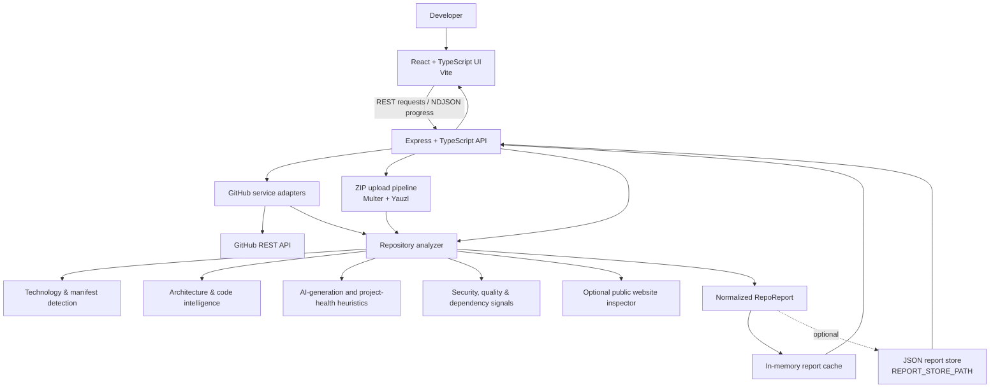
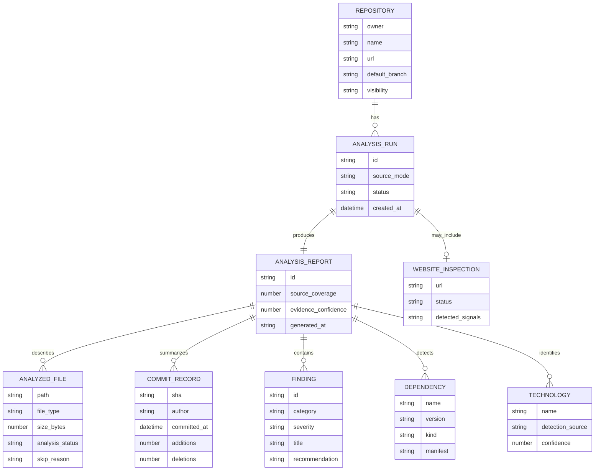

# ⚡ RepoScope

<p align="center">
  <strong>See the structure behind the code.</strong><br/>
  A repository intelligence workspace for exploring project architecture, development history, dependencies, and explainable code signals.
</p>

<p align="center">
  <a href="https://github.com/amitpaul2004/MASTER_WEB"></a>
  
  
  
  
  
</p>

---

## ✨ What can RepoScope do?

RepoScope turns a public GitHub repository or a ZIP archive into a structured, evidence-led project report.

- **🔎 Analyze GitHub repositories** — retrieve repository metadata, topics, default-branch files, language totals, and commit history.
- **📦 Analyze ZIP archives** — inspect a project's source/configuration files without extracting the entire archive or executing uploaded code.
- **🧭 Explore project structure** — browse files, inspect sampled source coverage, and view architecture relationships inferred from available evidence.
- **🧰 Detect technologies** — identify likely languages, frameworks, tools, manifests, and configuration fingerprints.
- **🕒 Understand development activity** — summarize contributors, commits, monthly activity, and selected commit-change details.
- **🧠 Review explainable code signals** — see observed patterns behind a deterministic AI-generation estimate, with evidence and limitations.
- **💚 Inspect project health** — review an internal heuristic based on project structure, tests, CI, README presence, and available history.
- **🛡️ Surface code risks** — inspect pattern-based security and maintainability findings, file risk indicators, dependencies, and optional vulnerability lookups.
- **🔗 Inspect a public website** — optionally check a public HTTP(S) website for basic metadata and technology fingerprints.
- **⚖️ Compare reports** — compare analyzed projects, file inventories, dependency information, and supported source diffs.
- **📄 Export results** — export JSON reports and use HTML/print-friendly report views.
- **💬 Ask questions about a report** — enable optional report-grounded Q&A by configuring a server-side, OpenAI-compatible chat endpoint.
- **📈 Track analysis progress** — receive typed NDJSON progress events and separate coverage, source-signal, and evidence-confidence information.
- **💾 Reopen reports** — use saved report identifiers in the browser; optional server-side JSON persistence is available.
- **🎨 Use a responsive workspace** — explore the dashboard on desktop and smaller screens, with motion-aware UI behavior.

> **Interpretation note:** AI-generation and project-health scores are heuristics, not proof, calibrated probabilities, certifications, or substitutes for a professional review. Findings depend on the evidence available to the analyzer.

## 🖥️ System architecture

The application is split into a React client and an Express API. Repository access, archive processing, and analysis run on the server; the browser receives normalized report data.



### Request lifecycle

1. The user submits a public GitHub repository URL or a ZIP archive.
2. The API validates the input and emits progress events.
3. For GitHub input, server-side adapters retrieve metadata, the repository tree, language totals, and bounded commit history. For ZIP input, the upload is streamed to a temporary file and only a bounded source sample is read.
4. Analyzers inspect the available files and metadata to create technology, architecture, risk, activity, and heuristic signals.
5. The API returns a normalized report that the frontend renders in the workspace.
6. Reports are cached in process memory; optional JSON persistence can be enabled with `REPORT_STORE_PATH`.

### Design principles

- **Server-side secrets:** GitHub and chat credentials belong in server environment variables, never in frontend code.
- **Bounded analysis:** file counts, file sizes, upload sizes, and sampled archive content have configurable limits.
- **Evidence over certainty:** inaccessible, skipped, or missing evidence is represented as a limitation instead of being silently treated as proof of absence.
- **No uploaded-code execution:** ZIP contents are inspected as data; RepoScope does not run the uploaded project.
- **Provider boundaries:** the UI consumes normalized report objects rather than depending directly on GitHub API response shapes.

## 🧩 Logical ER diagram

RepoScope does **not** currently require a relational database. Recent reports are stored in memory by default, and optional persistence writes report JSON files to a configured directory. The diagram below is a **conceptual data model** showing the main report objects and their relationships; it is not a diagram of existing SQL tables.



**Relationship notes**
- A repository can have multiple analysis runs; a ZIP analysis may have no GitHub repository identity or commit history.
- Each completed run produces a report containing file coverage, findings, detected dependencies/technologies, and available commit summaries.
- A website inspection is optional and is associated with a run only when a website URL is provided.
- The current implementation's report schema and persistence behavior are authoritative; this conceptual model is intended to help contributors understand the domain.

## 🧰 Technology stack

| Area | Technologies | Purpose |
| --- | --- | --- |
| Frontend | React 18, TypeScript, Vite | Responsive single-page application and development/build tooling |
| UI and icons | CSS, Lucide React | Workspace styling, interaction, and icons |
| Routing | React Router | Client-side navigation |
| Backend | Node.js, Express 4, TypeScript | REST API, analysis orchestration, streaming progress |
| GitHub integration | GitHub REST API, server-side service adapters | Repository metadata, trees, languages, commits, and source retrieval |
| ZIP handling | Multer, Yauzl | Disk-backed uploads and streaming archive inspection |
| Configuration | dotenv, environment variables | Local and deployment configuration |
| Dependency/security signals | Manifest parsing and optional OSV API lookup | Dependency context and vulnerability-related signals |
| Testing | Vitest, Supertest | Unit and API integration tests |
| Build | TypeScript compiler, Vite | Type-checking, client bundle, and compiled server output |

## 🚀 Run RepoScope locally

### Requirements

- **Node.js 20 or newer**
- **npm**
- Git (recommended)
- A GitHub account/token is optional for public repositories; a token helps with API rate limits.

### 1. Fork the repository

Open [amitpaul2004/MASTER_WEB](https://github.com/amitpaul2004/MASTER_WEB) and click **Fork**. Choose your GitHub account as the destination.

### 2. Clone your fork

Replace `YOUR_GITHUB_USERNAME` with your GitHub username:

```bash
git clone https://github.com/YOUR_GITHUB_USERNAME/MASTER_WEB.git
cd MASTER_WEB
```

If you cloned the original repository directly, use:

```bash
git clone https://github.com/amitpaul2004/MASTER_WEB.git
cd MASTER_WEB
```

### 3. Install dependencies

Run this from the repository root (the folder containing `package.json`):

```bash
npm install
```

### 4. Create your local environment file

macOS / Linux / Git Bash:

```bash
cp .env.example .env
```

Windows PowerShell:

```powershell
Copy-Item .env.example .env
```

Edit `.env` if you need to change settings. Leave optional values blank if you do not use those integrations. **Never commit your real `.env` file or put secrets in variables prefixed with `VITE_`.**

### 5. Start the frontend and backend

```bash
npm run dev
```

By default:
- Frontend: [http://localhost:5173](http://localhost:5173)
- API: [http://localhost:5000](http://localhost:5000)
- Health check: [http://localhost:5000/api/health](http://localhost:5000/api/health)

The Vite development server proxies `/api` requests to `http://localhost:5000`.

### 6. Verify the project

Run tests:

```bash
npm test
```

Create a production build:

```bash
npm run build
```

Start the compiled API after building:

```bash
npm start
```

## ⚙️ Environment variables

Copy `.env.example` to `.env` and configure only what you need.

| Variable | Default | Description |
| --- | --- | --- |
| `PORT` | `5000` | Port used by the Express API. |
| `CLIENT_ORIGIN` | `http://localhost:5173` | Exact trusted frontend origin allowed by CORS. In production, set this to your deployed frontend URL (scheme and hostname, no trailing slash). |
| `GITHUB_TOKEN` | Empty | Optional server-side GitHub token. Public repositories can be analyzed without one, subject to unauthenticated rate limits. |
| `ANALYSIS_MAX_FILES` | `25` | Maximum number of source/configuration files sampled; hard cap 500. |
| `ANALYSIS_MAX_FILE_BYTES` | `250000` | Maximum size of an individual source file read; hard cap 2,000,000 bytes. |
| `ZIP_MAX_UPLOAD_BYTES` | `3221225472` | Compressed ZIP upload limit (3 GiB by default; hard cap 3 GiB). |
| `ZIP_MAX_ANALYSIS_BYTES` | `67108864` | Decompressed source content budget for one ZIP analysis (64 MiB default; hard cap 128 MiB). |
| `ZIP_MAX_COMPRESSION_RATIO` | `200` | Safety threshold for suspicious compression ratios; hard cap 1000. |
| `CHAT_COMPLETIONS_URL` | Empty | Optional OpenAI-compatible chat-completions endpoint. |
| `CHAT_API_KEY` | Empty | Optional server-only credential for the chat provider. |
| `CHAT_MODEL` | Empty | Model identifier used by the optional chat provider. |
| `REPORT_STORE_PATH` | Empty | Optional directory for persisted report JSON. Use a protected, durable disk if persistence across restarts is required. |
| `OSV_API_URL` | `https://api.osv.dev/v1/query` | Endpoint for optional OSV vulnerability lookups. |

Use a narrowly scoped GitHub token and keep it on the server. Never expose `GITHUB_TOKEN` or `CHAT_API_KEY` to the browser.

## 🔌 API reference

### `GET /api/health`

Returns API status and current ZIP analysis limits.

### `POST /api/analyze`

Analyze a public GitHub repository. Send JSON:

```json
{
  "repositoryUrl": "https://github.com/OWNER/REPOSITORY",
  "websiteUrl": "https://example.com"
}
```

- `repositoryUrl` is required.
- `websiteUrl` is optional and is intended for a public website.
- The response uses newline-delimited JSON (NDJSON): progress records followed by a result record, or a safe error record.

### `POST /api/analyze/zip`

Analyze a ZIP archive using `multipart/form-data` with a single file field named `archive`. The configured default compressed upload limit is 3 GiB. Uploaded code is not executed.

### `GET /api/analysis/:id`

Retrieve a report by its analysis identifier. Without `REPORT_STORE_PATH`, reports are held in process memory and may disappear when the server restarts or the cache evicts older entries.

### `POST /api/compare`

Compare two report identifiers. The request body contains an `ids` array with exactly two valid analysis IDs:

```json
{
  "ids": ["ANALYSIS_ID_1", "ANALYSIS_ID_2"]
}
```

Other workspace endpoints support report intelligence, findings, dependency/advisory data, and optional report-grounded questions. See `server/src/index.ts` for the current route definitions.

## 📏 Analysis methodology and limits

- GitHub repository trees may be truncated by GitHub; RepoScope surfaces incomplete coverage.
- The application retrieves up to 500 default-branch commits and requests detailed file-change statistics for the latest 20 commits to bound API usage.
- Source files are sampled using configuration prioritization and round-robin source-folder sampling. The default is 25 files, with a configurable per-file byte limit.
- Lockfiles, generated/minified files, dependency/vendor directories, build output, unsupported formats, binary content, and oversized files are excluded from ordinary source signals and reported as applicable.
- ZIP entries are inspected without extracting the complete archive. The archive is streamed to a temporary file, paths and symlinks are checked, and only a bounded sample is read. Temporary uploads are removed after processing.
- The 3 GiB ZIP setting is an application limit, **not a guarantee that every hosting provider or reverse proxy accepts a 3 GiB request**. Configure request-body limits, timeouts, disk capacity, and concurrency for your deployment. Many serverless/static platforms have lower request-size limits.
- Website inspection is limited to public HTTP(S), rejects credentials and local hostnames, disables redirects, applies a timeout, and inspects only a bounded amount of HTML. Some websites may block requests or be unreachable.
- Technology detection uses observed manifests/configuration and limited source fingerprints. Missing detection is not proof that a technology is absent.
- AI-generation signals are deterministic heuristics based on observable source/history patterns. Templates, conventions, generated code, and human-written code can produce similar signals. The score is **not proof of AI authorship**.
- Project Health is an internal heuristic, not an industry-standard grade or a substitute for manual code, security, or maintenance review.
- Incomplete source samples and missing commit metadata can reduce evidence confidence. Reports distinguish signal scores from evidence confidence and repository coverage.

## 🔐 Security and privacy

- Keep all tokens and API keys in server-side environment variables.
- Do not commit `.env` or add secrets to frontend `VITE_*` variables.
- ZIP uploads are treated as untrusted data; uploaded code is never executed.
- Archive paths and symlinks are validated, and analysis uses bounded file/content budgets.
- Optional website inspection targets public HTTP(S) pages and applies input and network safeguards.
- Review deployment storage, access control, logging, and resource limits before using RepoScope with sensitive or high-volume workloads.

## 🌍 Deployment notes

### Frontend

Build the Vite application:

```bash
npm run build
```

The static frontend output is in `dist/`. Set `VITE_API_BASE_URL` to the public backend base URL if your deployment uses an absolute API URL. For local development, the default empty value uses the Vite `/api` proxy.

### Backend

Deploy the Node.js API as a persistent Node service and run:

```bash
npm run build
npm start
```

Set `CLIENT_ORIGIN` to the exact deployed frontend origin, for example `https://your-frontend.onrender.com`. Set optional server secrets through your hosting provider's environment settings. If you enable `REPORT_STORE_PATH`, use a durable protected disk.

> **Large ZIP uploads:** verify the limits of your host, load balancer, and proxy before advertising support for 3 GiB uploads. Application configuration alone cannot override a platform's request-body limits.

## 🧪 Development commands

| Command | What it does |
| --- | --- |
| `npm run dev` | Starts the API and Vite frontend in watch mode. |
| `npm run dev:server` | Starts the Express API in watch mode. |
| `npm run dev:web` | Starts the Vite development server. |
| `npm run build` | Type-checks the frontend, builds the frontend, and compiles the server. |
| `npm start` | Starts the compiled API. |
| `npm test` | Runs the Vitest test suite. |
| `npm run preview` | Previews the production frontend build locally. |

## 🤝 Contributing

Contributions, bug reports, and ideas are welcome.

1. Fork the repository.
2. Create a focused branch: `git checkout -b feat/your-change`.
3. Make your change and add/update tests where practical.
4. Run `npm test` and `npm run build`.
5. Commit with a clear message and push your branch.
6. Open a pull request describing the problem, the approach, and any testing performed.

Please avoid committing secrets, generated build output, uploaded archives, or local environment files.

## 🗺️ Roadmap ideas

- More language-specific analyzers and richer dependency ecosystem support.
- Improved architecture relationship inference with clearer evidence links.
- Optional durable report storage backed by a dedicated database.
- Additional export formats and comparison views.
- More extensive tests for large repositories, incomplete GitHub metadata, and deployment-specific upload limits.

## 📄 License

Check the repository's license file (if present) before redistributing or using this project. If no license is included, do not assume that the source is licensed for unrestricted reuse.

---

<p align="center">
  Built to make repository exploration clearer, more explainable, and more useful for developers.
</p>
